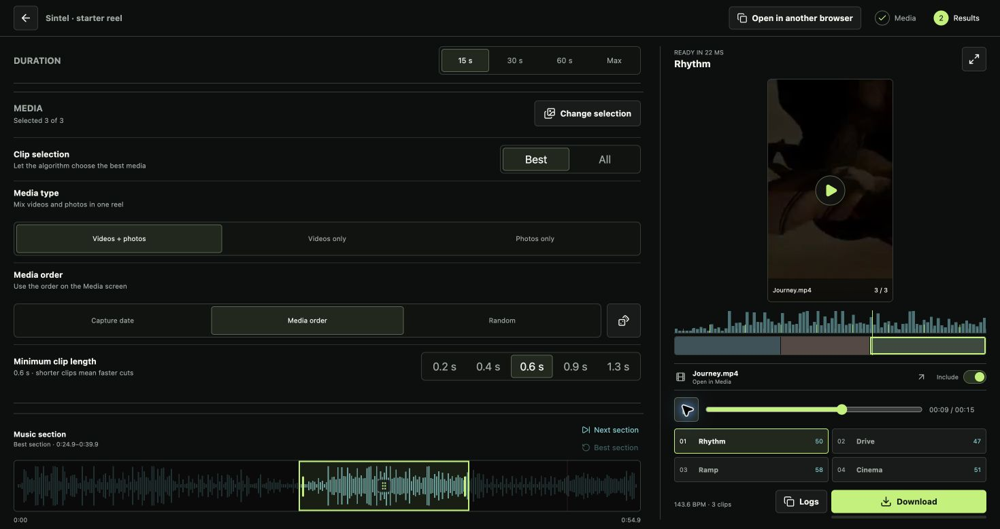
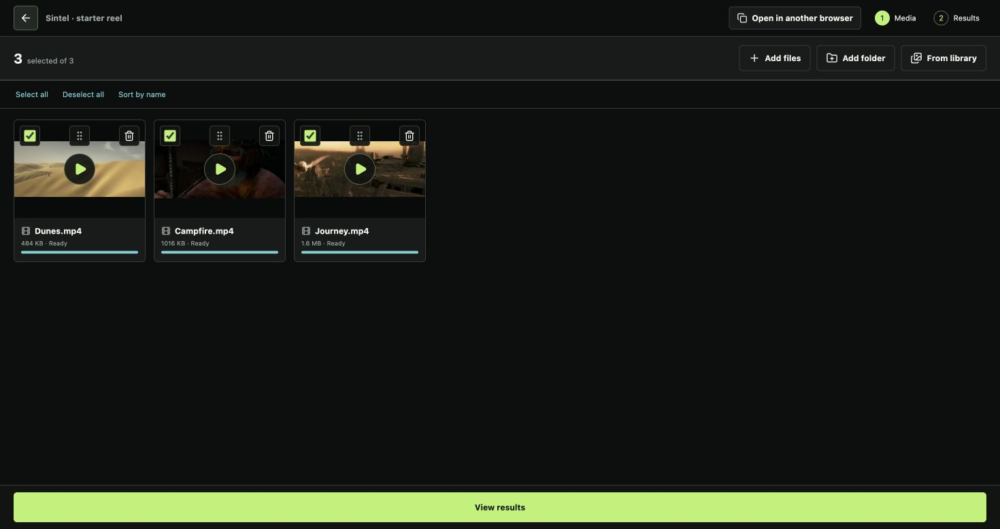

# Reel Lab

**Want to try it? Give your coding agent this repo and paste:**

```text
Clone this repository and run Reel Lab on my computer.
Follow INSTALL.md, verify the app and included soundtrack work,
then open the editor in my browser.
```

**You filmed the day. Let Reel Lab make the reel.**

Drop in your videos and photos. Pick a song. Get four vertical edits, choose your favorite, and download it. Everything runs on your computer.

Made by **[Timofey Korchagin](https://github.com/tkorchagin)**.



## How it started

My wife and I raced [HYROX](https://hyrox.com/the-fitness-race/): eight runs, eight workout stations, and a camera roll full of memories. Great day. Absolutely no desire to spend the evening editing it.

So I vibe-coded an editor that would do the tedious part for us. The first reel was surprisingly good. Getting it consistently good was where the fun started.

## From camera roll to reel

1. **Add your footage.** Create a project, drop in files or a folder, and let the app scan them. Deselect anything you don't want; drag clips to change their order.
2. **Pick the mood.** Open Results, choose a length and a song. A starter track is included, so you can try it immediately.
3. **Compare four takes.** **Rhythm** keeps a steady pulse. **Drive** mixes bursts with breathing room. **Ramp** builds momentum. **Cinema** lets shots linger.
4. **Make it yours.** Try another part of the song or longer shots. Click the timeline to inspect a moment; press **Space** to play. Download the version you like.



## What the algorithm actually does

First, it scans your footage for promising moments: movement, faces, sharpness, and exposure. It looks inside a shot for an action peak, rather than just taking its first few seconds.

Then it listens for the song's pulse and changes in energy. Each style turns those into a different cutting pattern: a steady groove, quick bursts, a build, or slower scenes.

Finally, it fits the shots into a vertical frame, using faces or visual detail to guide the crop. You get four previews before committing to an export. It can't know which moment means the most to you, so you keep the final say.

## The bits that fought back

**“Why does my phone footage look washed out?”** The early version mishandled HDR. I fixed the color conversion so bright phone footage survives the export.

**“That's the right tempo. Why are the cuts off?”** Knowing the speed of a song isn't enough: you also need to find the pulse. I made it check the part of the song you're actually using and line the cuts up with its beats.

**“It's on beat, but it feels like a slideshow.”** More cuts didn't help. Giving each style its own phrasing, pauses, and bursts did.

**“Good clip. Wrong moment.”** A scene can include a lot of waiting around one second of action. I made the editor look more closely inside it and choose around the peak.

**“Did the edit miss, or did the player stutter?”** The preview now follows the music and prepares the next shot ahead of time. Scrubbing shows the moment you picked, even while paused.

## Bring your own music

Already have the perfect song? Add it to `backend/data/audio-library/` and restart the app. You can keep tracks in subfolders. [Your agent's setup guide](INSTALL.md#add-more-music) has the details.

## A few things to know

This is a local browser app; [INSTALL.md](INSTALL.md) handles setup. Keep it running while it processes or exports. To open your projects in another browser, use **Open in another browser**.

Already-baked black borders in a source video need cropping first. Your footage and projects stay local; keep `backend/data/` out of Git.

## Credits

Code: **[MIT](LICENSE)**, © 2026 Timofey Korchagin. [Soundtrack credits](backend/src/reel_lab/assets/demo-music/CREDITS.md) · [Model credits](docs/models.md).

Screenshots use **Sintel**, © Blender Foundation ([durian.blender.org](https://durian.blender.org/)), under [CC BY 3.0](https://durian.blender.org/sharing). [Footage credits](docs/screenshots/CREDITS.md).
